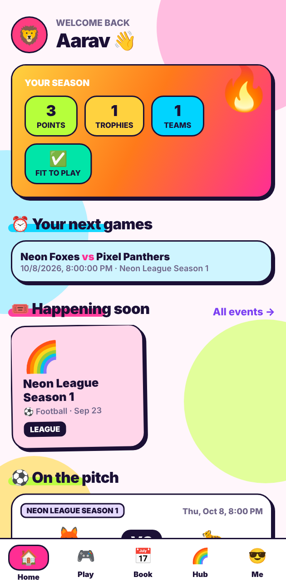
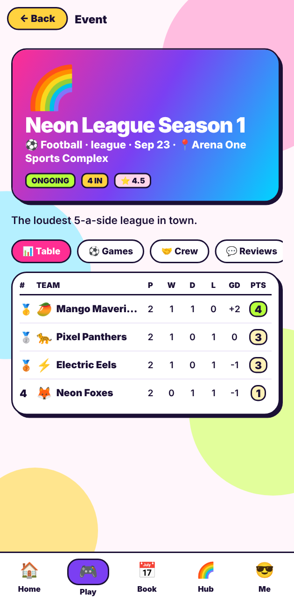
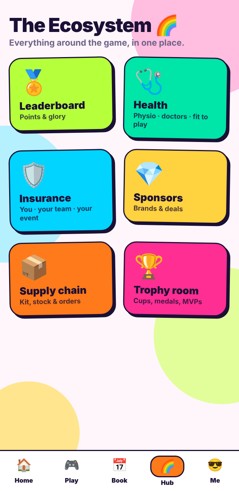
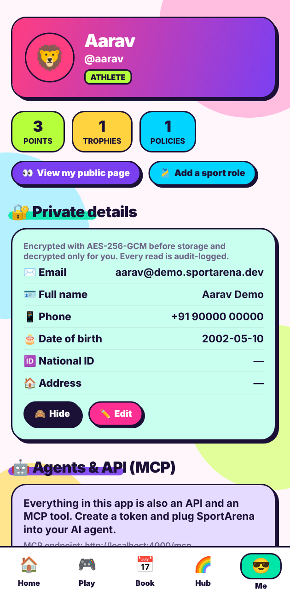

# 🏆 Gotmygame

**One platform for everyone who dreams of sport** — athletes, coaches, referees, organizers, venues, sponsors,
physios & doctors, suppliers and insurers. **API-first. MCP-first.** One React Native codebase for iOS, Android and web.

| | |
|---|---|
|  |  |
|  |  |

## What's in the MVP

| Area | What you can do |
|---|---|
| **Identity & people** | Register with roles (athlete, coach, referee, organizer, venue manager, sponsor, physio, doctor, supplier, insurer); sport profiles per role; public profiles with no PII; API tokens |
| **Command centres** | One Home for every role (athlete, guardian, coach, team manager, org admin, event manager, official, doctor, physio, sponsor, supplier, venue operator, agent, media, volunteer): role switcher, then Today / Actions / Calendar / Inbox / Work / Insights, one-tap answers and exact deep links, pins, saved filters — see [docs/command-centres.md](docs/command-centres.md) |
| **Teams** | Create teams, trophy cabinet, fan wall; **team management** — roster, player availability, invitations, recruiting players/coaches, per-event & per-match squads with roles, rates and a settlement ledger; **team chat**; **team workspace** — task board, master team + per-event sub-teams, RSVP/attendance — see [docs/teams.md](docs/teams.md) |
| **Events & schedule** | Tournaments/leagues/camps/trials, entries + approval, **auto round-robin scheduling**, referee + team clash detection, results, **live standings with configurable points**, one-click "finish & award" (cup/silver/bronze) |
| **Public tournament & spectator experience** | One public event page for everyone, signed in or not: live games, schedule, provisional/final table, bracket (drawing and list), awards, approved media, sponsor placements with measured exposure, follow with alerts (start, score, result, schedule change), a live centre per game, share cards and server-rendered share pages, discovery by live/upcoming/completed, organiser visibility policy (public, link-only, private), youth-safe by default, opt-in fan reactions and MVP vote — see [docs/public-spectator.md](docs/public-spectator.md) |
| **Find & join games** | Host an open game at a real venue (or a public place) and find one: by sport, now / today / this weekend, distance, level, cost and free seats, with the reason each game was suggested. Join with approval or auto-approval, a fair waitlist, a temporary game chat, check-in that flows into sports history, factual (appealable) no-show records, "need players" suggestions that are opt-in and never pay-to-rank, and guardian-controlled joining for young players — see [docs/open-games.md](docs/open-games.md) |
| **Event planning** | Create an event with one or several sports, a calendar date range and a booking request per venue (only venues that have the sports); contact teams, coaches, referees, physios/doctors, suppliers, venues, insurers and sponsors with invite → quote → finalize; budget with committed vs paid, spend cap, contingency and alerts; dated planning checklist — see [docs/event-planning.md](docs/event-planning.md) |
| **Multi-sport events** | A sports day / Olympics-style event with many sports: houses & groups, nominations (one person, several sports, limits), team building, qualifying heats → finals, a clash-free auto-schedule across sports, referee/physio/doctor hiring with shifts and medical-cover gaps, on-site incident log (encrypted), points for people/teams/houses, certificates with verification codes, trophies, announcements incl. guardians — see [docs/multi-sport-events.md](docs/multi-sport-events.md) |
| **Coaching** | Coach home, relationship-governed athlete roster, shared training plans (propose → athlete accepts/changes, versioned revisions), coach calendar, scoped team-coach roster view — [docs/coach-marketplace.md](docs/coaching.md) |
| **Athlete health & recovery** | Daily readiness score, quick logs (water, mood, soreness, sleep, notes), tap-to-rate body map, workload (acute:chronic) gauge — private to the athlete, notes encrypted; see [docs/athlete-health.md](docs/athlete-health.md) |
| **Education pathways** | Learn a sport's rules, search courses/certifications/degrees and colleges, retrieve contacts, and enquire through the platform; institutions (an organisation of kind college/university) review enquiries, reply with brochures, route to their website, move people through apply → admitted → enrolled, announce to consenting enquirers, introduce them to sponsors and issue certificates/badges that show on the athlete's profile and passport — see [docs/education-pathways.md](docs/education-pathways.md) |
| **Calendar sync & availability** | Private ICS subscription links (Apple, Google, Outlook), import of other calendars as busy time, weekly availability windows, travel buffers, time-zone-aware real-duration conflict list with safe fixes; guardian-controlled for young people; see [docs/athlete-schedule.md](docs/athlete-schedule.md) |
| **Player passport** | Shareable, expiring, revocable athlete CV (sport cards, season-by-season matches, approved results, awards) as a link or QR code for coaches and scouts, now with approved video, coach references, recruitment preferences, availability, optional academic evidence and person-addressed links; no personal identification data; see [docs/player-passport.md](docs/player-passport.md) |
| **Player marketplace** | Billboard of demands (players wanted for a match, teams recruiting, sponsorship requests/calls) with accept/decline; sports shop with atomic stock + encrypted delivery address; hire coaches (search, profiles, open-hour booking, posted requests with compared answers, reviews, payments tracker — see [docs/coach-marketplace.md](docs/coaching.md)); buy personal insurance. Billboard, Shop and My cover live under **More**; coaches are hired under **Schedule → Coaches** (physios and doctors are found and booked once, under Health) |
| **Player contracts & payouts** | Accepted playing opportunities become versioned contracts (fees, bonuses, monthly and dated pay, tax withheld, expense limits) with amendments that every party signs, earnings posted from verified appearances, expenses with receipts, an append-only ledger, payout runs with a second-person approval and a bank file, statements and credit notes, and a club/event desk — on phone, tablet and web; guardian-aware, audit-logged, REST + MCP. See [docs/player-contracts.md](docs/player-contracts.md) |
| **Player funding** | One workspace for a player (or guardian, or a coach they choose): funding needs with live coverage, sponsorship applications and offers, agreements, every due with paid / confirmed / goods position, next actions, CSV export and revocable sharing — see [docs/player-funding.md](docs/player-funding.md) |
| **Partner management** | A separate platform console: onboard / modify / suspend / offboard venue partners, **platform approval for every new venue**, platform-owned price list (venue price changes are requests the platform approves, counters or rejects; platform pricing overrides venue pricing), generated & customised contracts, revenue **settlement** per contract, revenue / settlement / **P&L** reports, and platform staff only the platform owner can add — see [docs/partners.md](docs/partners.md) |
| **Payments** | Stripe + PayPal hosted checkout for shop orders, coach sessions and insurance; verified webhooks, refunds on cancel — see [docs/payments.md](docs/payments.md) |
| **Loyalty, referrals & rewards** | One engine for platform, venue, academy, coach and event programmes: versioned published rules, an append-only ledger with expiry/reversal, earning from completed business events (idempotent), redemption on venue bills, academy fees and coaching sessions (atomic, restored by policy), referral codes with qualifying event + holdback and loop/self/duplicate-device protection, sponsor-funded rewards tied to an active sponsorship, liability & breakage reporting, zero effect on rankings — see [docs/loyalty.md](docs/loyalty.md) |
| **Advertising** | Paid, clearly labelled reach for venues, coaches, events and businesses — kept apart from every organic list, ranking, tender and review: nine placement types (featured venue / coach / academy / event, promoted supplier, sponsored post, event and scorecard display, sponsored search slot), campaigns with sport / place / search-word targeting and frequency caps (never health, legal, insurance, youth or precise-location data), reviewed before they run, prepaid with a concurrency-safe budget and a refund of what was not spent, and measured only by views and clicks from append-only delivery records; young people and youth events get none unless the platform allows approved contextual ads; platform-admin review desk; people can hide or report any ad — on phone, tablet and desktop; REST + OpenAPI + MCP; see [docs/advertising.md](docs/advertising.md) |
| **Cover — someone else pays** | A sponsor, club, parent or friend pays a person's bookings, memberships, sessions, fees, appointments and orders under an agreement both sides approve: one time, for a period or unlimited, with per-bill/total caps; requests and offers, organisation payers, guardians for young people, instant revocation, generic bill labels only — see [docs/cover-payments.md](docs/cover-payments.md) |
| **Scores & awards** | Individual performances (goals, times…) with evidence labels — self-reported practice vs officially approved competition results ([verified scoring](docs/verified-scoring.md)) — personal stats/bests, official leaderboards, cups/trophies/medals/MVP/badges |
| **Player** | One card per sport profile (default always first), match-by-match performance with sport-specific stats, bulk import from CSV/JSON, Excel, Word, PDF or a photo (files are read in memory, never stored; PDFs/photos need AI) with a downloadable template, dry-run + row-level errors |
| **Venues, grounds, courts, equipment** | Resource catalogue with capacity + hourly price, availability, **race-free bookings** (advisory-locked; equipment pools supported); fixtures can book the pitch atomically |
| **Venue management & reservations** | Any sport; many courts/tables per venue with their own capacity, players and slot length; geo + map links, hours, encrypted contacts, staff; peak/off-peak **pricing rules**, **discounts** & promo codes; **multi-slot / multi-court / multi-venue** atomic reservations, **compare venues**, modify & cancel with a refund policy; **bulk blocks**, admin **override**, **reports**, **notifications** — **lockers with per-booking PINs**, maintenance, vendors, contracts, packages & subscriptions — see [docs/venue-reservations.md](docs/venue-reservations.md) |
| **Sports front desk & POS** | One cart for a walk-in court, merchandise, food & drink, equipment **rental** (fee + deposit + return/damage/loss), memberships and fees collected at the desk — drawing down the venue's own stock atomically and billed on the canonical numbered invoices; cash / hand-recorded card & UPI tenders vs provider-confirmed online payments, **cash drawer shifts** with immutable variance, cashier limits with **one-time manager approvals**, returns as linked credit notes, receipts, and a report that reconciles to invoices, payments and stock — see [docs/front-desk.md](docs/front-desk.md) |
| **Recurring collections & dunning** | One work queue for money owed repeatedly (academy fees, club dues, venue membership renewals): frozen recurring schedules that raise one charge and invoice per period, part payments, waivers and concessions that reconcile to the balance, payment plans, reminder cadence and retries through the shared notifications, promises and holds, escalation, optional late fees and access pause (off by default, reversible, nothing deleted), guardian billing for young people, mandate state kept apart from payment state, and a per-currency report — on phone, tablet and desktop; REST + OpenAPI + MCP; see [docs/collections.md](docs/collections.md) |
| **Omnichannel communications (India)** | One delivery layer for in-app, push, email, **WhatsApp Business** (official Cloud API, approved templates) and **SMS** (DLT-ready gateway bridge) behind the existing `notify()`: typed template variables (no free text), consent evidence, STOP and number suppression, fallback channels, signed replay-safe delivery receipts with honest queued / sent / delivered / read / failed states, per-organisation quotas and usage, and a Communication settings screen on phone, tablet and web — see [docs/communications.md](docs/communications.md) |
| **Team travel** | Trips and delegations tied to real events and fixtures: travel party from the roster, trip-specific guardian consent for young travellers, timezone-safe versioned itineraries, stays and private rooming, passport/visa readiness (numbers encrypted, never shown to staff), equipment consignments, a daily movement board, disruption impact, per diem and expenses that keep entitlement, claim, payment and balance apart, supplier-order links and audience-safe reports — on phone, tablet and desktop; REST + OpenAPI + MCP; see [docs/team-travel.md](docs/team-travel.md) |
| **Academy operations** | Term timetables with preview and conflict checks, staff rostering, availability, leave and cover, ratio and credential checks, session attendance (idempotent scans), timesheets, effective-dated compensation and approved payroll statements, an Operations Today screen, coach phone agenda and athlete/guardian sessions — see [docs/academy-operations.md](docs/academy-operations.md) |
| **Sponsors** | Brand profiles (encrypted contacts), offers to events/teams/athletes, accept/decline workflow, **funding programs & rounds** with applications and awards ([docs](docs/sponsorship-programs.md)), **award approvals and conditional offers** ([docs](docs/sponsorship-awards.md)), **pause and resume of agreements** ([docs](docs/sponsorship-pause.md)) |
* Term expiry, final settlement and explicit renewals: [`docs/sponsorship-renewals.md`](docs/sponsorship-renewals.md)
* Tasks, assignments, notes, reminders and escalation for sponsors and recipients: [`docs/sponsorship-collaboration.md`](docs/sponsorship-collaboration.md)
* ROI & portfolio intelligence — governed inventory with conflict-aware bookings, deliverables with evidence and reviewer acceptance, measured exposure with published definitions, brand-owned valuation estimates, comparison, factual renewal packs and immutable issued reports: [`docs/sponsorship-roi.md`](docs/sponsorship-roi.md)
| **Supply chain** | Inventory, low-stock flags, supplier orders; receiving an order restocks atomically |
| **Health** | Find physios/doctors, appointments, **athlete-controlled consent**, encrypted clinical notes, fit-to-play status without clinical detail |
| **Insurance** | Plans for individual / team / event, policies (encrypted number + beneficiary), claims with coverage checks, admin review |
| **Verification** | Request a verified badge (gamer, coach, physio, doctor, sponsor, event) as a case with encrypted evidence; platform-team queue with reviewer checklist, decisions, expiry and revocation — see [docs/verification.md](docs/verification.md) |
| **Insurance** | An `insurer` role with its own desk (profile, plans + labelled offers, quote inbox, book of business, claims); searchable/comparable plans; quote requests for a person, team, event or tournament, tracked end to end; accept a quote → cover assigned → pay; renewals with reminders; encrypted document locker; claim review — see [docs/insurance.md](docs/insurance.md) |
| **Doctors & physios** | Public provider profiles, weekly hours and bookable slots, server-side search (type, sport, location/remote, price, rating, verified), scoped and revocable consent — see [docs/health.md](docs/health.md) |
| **Physio workspace** | Session notes, measured outcome tracking, rehab goals, home-exercise adherence, published progress reports, rule-based suggestions and practice insights, with a matching patient view — see [docs/physio-workspace.md](docs/physio-workspace.md) |
| **Health-data governance** | Rules for 11 countries (US, UK, Canada, UAE, India, Singapore, Malaysia, China, Japan, Australia, New Zealand) as operator reference: choose your country and read its notice, see **who accessed your data**, rights requests with the country's deadline (access, correction, restriction, objection, erasure — nothing is ever deleted, records are held until their retention date), one-click data export, cross-border remote-care confirmation, privacy-incident register with regulator clocks, compliance posture for the platform team and a practice checklist for clinicians — not legal advice; see [docs/health.md](docs/health.md#health-data-governance-across-11-countries-us-uk-canada-uae-india-singapore-malaysia-china-japan-australia-new-zealand) |
| **Support & disputes** | Support tickets and disputes as one case model that links bookings, payments, events or games; user thread vs internal notes, SLA queue, escalation, immutable timeline — see [docs/cases.md](docs/cases.md); sponsorship disputes with reviewers, risk flags and appeals: [docs/sponsorship-disputes.md](docs/sponsorship-disputes.md) |
| **Youth & guardians** | Verified guardian–child links (invite, accept, evidence, platform review, expiry), purpose-specific consent (participation, medical, media, contact), restricted youth visibility, pickup delegation and check-in, jurisdiction-configurable age policy — see [docs/guardians.md](docs/guardians.md) |
| **Community** | Ratings & testimonials for people, teams, events, venues, sponsors |
| **Compliance & evidence engine** | One versioned, effective-dated rule engine for procurement, event permits, federation eligibility, accreditation, youth safeguarding and privacy: jurisdiction packs as data (India, USA, Canada, Singapore, Malaysia, Sri Lanka, Australia, UK first), precedence by classification and jurisdiction, evidence reviewed by a second person, exceptions, an immutable decision audit trail, and explanations that never assert legal compliance; federation policies (#68), eligibility (#477), tenders (#460) and accreditation (#481) reuse it — see [docs/compliance.md](docs/compliance.md) |
| **Legal** | Verified lawyers, jurisdiction packs gated on local-counsel approval, private intake with conflict checks, versioned quotes, engagement and matters (phase 1, see [`docs/legal.md`](docs/legal.md)) |

## Architecture: one capability registry → REST + OpenAPI + MCP

```
apps/api/src/capabilities/*.js   ← every feature is ONE definition: name, schema (zod), roles, handler
          │
          ├── http.js     REST routes      /api/v1/...      (+ /api/v1/openapi.json, generated)
          ├── mcp.js      MCP tools        POST /mcp  (Streamable HTTP)  and  npm run mcp (stdio)
          └── invoke.js   the single place auth, validation and handlers run
apps/app/                        ← Expo (React Native + react-native-web); talks only to the REST API
```

REST, the generated OpenAPI spec and MCP tools **cannot drift**: there are 240+ capabilities and the tests assert
`tools/list` and the OpenAPI operations both equal the registry. The mobile/web app is just another API client — no
privileged backdoors — so anything a user can do in the app, an agent can do over MCP with the same permissions.

### Use it from an AI agent
1. In the app: **Me → Agents & API → New API token** (or `POST /api/v1/me/tokens`).
2. Point your MCP client at `http://localhost:4000/mcp` with `Authorization: Bearer sa_…`
   (see [`.mcp.json.example`](.mcp.json.example); a stdio server is included too).
3. Tool names match OpenAPI `operationId`s, e.g. `create_event`, `generate_round_robin`, `create_booking`, `record_result`, `buy_policy`.

Full end-to-end picture (components, runtime flows, trust boundaries, deployment, failure modes): [docs/architecture.md](docs/architecture.md).

## Security model for personal data

* **Field-level encryption at rest** — AES-256-GCM, random IV per value, ciphertext **bound to its column** (AAD), keys derived by HKDF from `SPORTARENA_MASTER_KEY`. Encrypted: email, full name, phone, date of birth, national ID, address, license numbers, sponsor contacts, appointment reasons, medical records, policy numbers, beneficiaries, claim descriptions. A DB dump alone reveals none of it (a test asserts this).
* **Blind index** — email lookup for login uses HMAC-SHA256, so email is never stored in plaintext, even for lookups.
* **Passwords** — scrypt with per-user salt, constant-time compare.
* **In transit** — HTTPS enforced in production (HTTP gets `426`), HSTS preload, in-process TLS 1.2+ (`SSL_KEY_FILE`/`SSL_CERT_FILE`) or behind a proxy (`TRUST_PROXY`), `DATABASE_SSL=true` for TLS to Postgres, `Cache-Control: no-store`, helmet headers, rate limits (strict on auth).
* **Least exposure** — public endpoints return handles/display names only. Decrypted data goes only to its owner (or, for health data, a provider the athlete explicitly consented to — revocable any time).
* **Audit trail** — every read of decrypted PII/clinical data writes to `audit_log` (who, what, when — never values).
* **Mobile** — token stored in Keychain/Keystore via `expo-secure-store`.

### Known limits (next steps, deliberately not faked in the MVP)
* The master key lives in an env var. For production use a KMS/HSM and rotate via the `v1.` ciphertext prefix (versioning is already in the format).
* Provider/referee/physio/doctor roles are self-declared; add credential verification by an admin before real clinical use. (Consent still protects athletes: an unverified "doctor" sees nothing without a grant.)
* Payments use hosted checkout (Stripe/PayPal, see [docs/payments.md](docs/payments.md)); payouts to sellers, coaches and venues are not built.
* Encryption at rest of the Postgres disk/backups is an infrastructure concern; this app encrypts the sensitive fields itself on top of it.
* Web stores the token in `localStorage`; ship with a strict CSP (or move to httpOnly cookies) before launch.

## Run it

Requirements: Node 22+, PostgreSQL 14+ (needs `gen_random_uuid()`; Postgres 15+ for `UNIQUE NULLS NOT DISTINCT`).

```bash
npm install
npm run setup            # writes .env with fresh keys (never commit it; losing the master key = losing the data)
createdb sportarena      # and edit DATABASE_URL in .env if needed
npm run migrate
npm run seed             # demo data; password for all demo users: sportarena-demo
npm run api              # → http://localhost:4000  (REST /api/v1, OpenAPI /api/v1/openapi.json, MCP /mcp)
npm run app              # Expo dev server: press w (web), i (iOS), a (Android) or scan the QR
```

Demo logins (`@demo.sportarena.dev`): `aarav` (athlete), `kavya_events` (organizer), `arena_one` (venue), `volt_drink` (sponsor), `dr_rhea` (doctor), `ref_imran` (referee), `admin`.
On a physical phone set `EXPO_PUBLIC_API_URL=http://<your-LAN-ip>:4000`.

```bash
npm test                 # end-to-end suites against a real Postgres (TEST_DATABASE_URL to override)
```
The suite covers: ciphertext-only storage & column binding, role gating, API tokens, tournament lifecycle,
**8 parallel bookings for one court → exactly 1 wins**, referee/team clash detection, consent-gated medical records,
insurance & claims, sponsorship approval rules, supply receiving, testimonials, and MCP ↔ REST ↔ OpenAPI parity.

## Deployment
AWS EC2 (pm2 + Docker Postgres + nginx, KMS-wrapped keys), side by side with other apps: see [`docs/deployment.md`](docs/deployment.md).

## Roadmap
Payouts / settlement · knockout & group-stage brackets · media (photos/video highlights) ·
KYC · multi-currency & i18n · organizations/clubs · webhooks · offline mode in the app.
