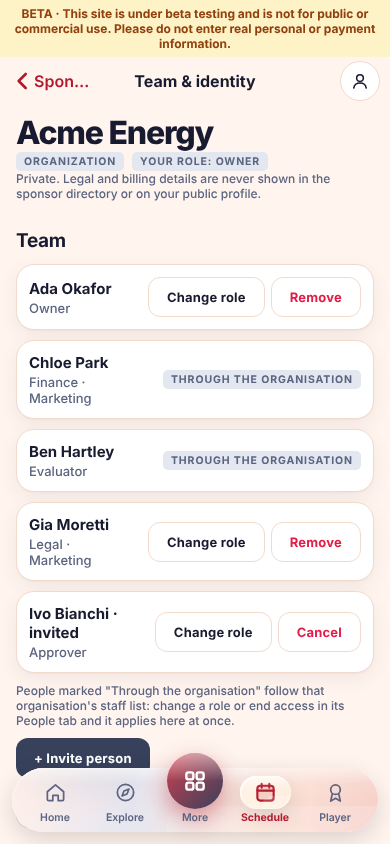
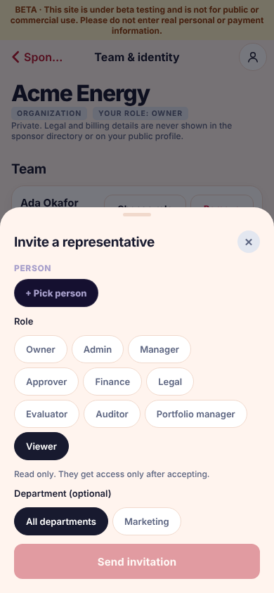
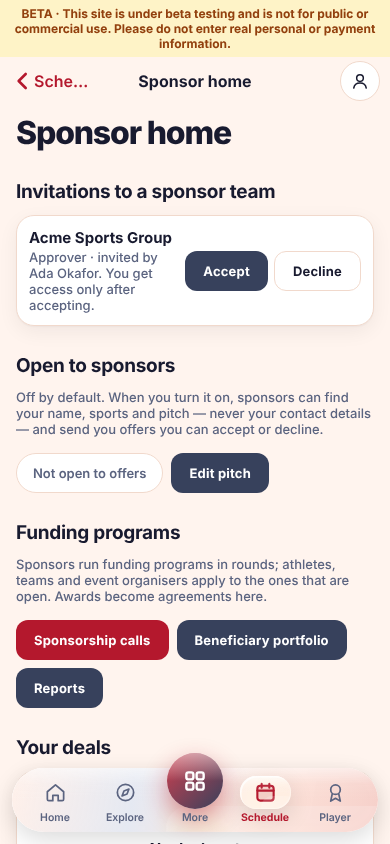
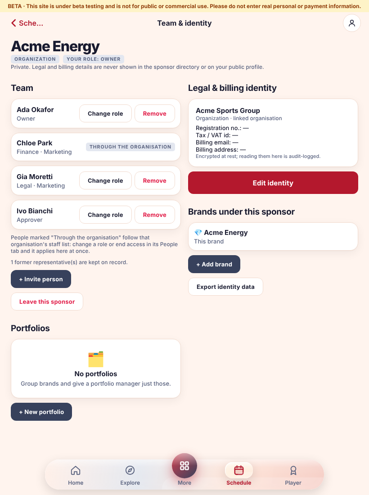
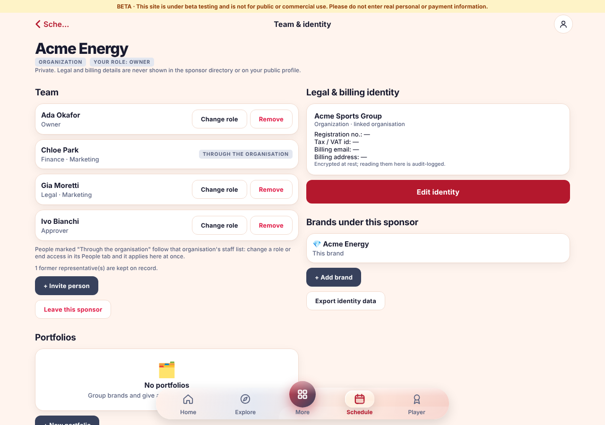

# Sponsor identities (#282)

Individual, company and organization sponsors with a legal and billing identity, authorised representatives, several
entities per person, portfolios of brands, and a frozen identity per agreement version. Everything extends the existing
`sponsors` / `sponsorships` tables and the shared `cap(...)` registry (REST + OpenAPI + MCP); there is no second sponsor
system, ledger or verification process.

## Model
* `sponsor_entities` — the legal/billing identity: `sponsor_type` (`individual|company|organization`), `legal_name`,
  `registration_country` (ISO alpha-2), encrypted `registration_number_enc`, `tax_id_enc`, `billing_email_enc`,
  `billing_address_enc`, optional `organisation_id` (an existing organisation, organization sponsors only), `row_version`.
* `sponsors` (the **brand**, public display name) gets nullable `entity_id` and `archived_at`. One entity owns many
  brands; one person can run several entities.
* `sponsor_representatives` — per entity: `owner` (several allowed) · `admin` · `manager` · `approver` · `finance` · `legal` ·
  `evaluator` · `auditor` · `portfolio_manager` · `viewer`, optional `department_id`, `source` (`manual|organisation`);
  status `invited → active → left` (or `declined`). Nobody is deleted; leaving sets `left_at`.
* `sponsor_portfolios`, `sponsor_portfolio_brands`, `sponsor_portfolio_assignments` — owner/admin groups brands and
  assigns portfolio managers; removal sets `removed_at` / `ended_at`.
* `sponsorship_identity_snapshots` — per `(sponsorship, version)`: display name, legal name, type and who proposed, written
  when the version is proposed or revised (first write wins). Registration/tax/billing are never copied.

## Permissions (server side, read live on every call — `src/sponsor-access.js`)
| Role | read | make/revise/withdraw offers, objectives, reviews | payments, goods, endorsements | identity, team, portfolios, verification |
|---|---|---|---|---|
| owner / admin | ✓ | ✓ | ✓ | ✓ (only owners appoint or change owners and admins) |
| finance | ✓ | – | ✓ | – |
| portfolio_manager | only brands in an assigned portfolio | ✓ (same brands) | ✓ (same brands) | – |
| viewer | ✓ | – | – | – |

A brand **without** an entity (every pre-existing brand) is controlled by its `owner_id` alone, exactly as before. Once a
brand belongs to an entity only active representatives (and platform admins) have access, so removing someone ends their
access immediately. The entity always keeps at least one active owner. Outsiders get 404, not 403, so existence is not leaked.

## API
`get_sponsor_identity`, `set_sponsor_identity` (needs `row_version`; stale → 409 with the current version),
`attach_sponsor_brand`, `list_my_sponsor_identities` (entities, invitations, brands still without identity),
`list/invite/respond/update/remove_sponsor_representative(s)`, `create/list/update_sponsor_portfolio`,
`export_sponsor_identity` (owner/admin, audit `export_pii`). `create_sponsor` accepts `sponsor_type`/`legal_name` (new
entity you own) or `entity_id` (another brand under an entity you own or administer). Decrypting registration/tax/billing is
audit-logged (`read_pii`). `get_sponsorship` returns `sponsor_identity` (the frozen snapshot). The verification reviewer
view (`get_verification`) shows the declared legal name, type and country for the checklist item "registered name matches";
verification is requested by owner/admin representatives and still uses the existing sponsor rules.

## Privacy
`list_sponsors` / `get_sponsor` return only display name, industry, website, emoji, `sponsor_type` and the verified badge.
Legal name, registration, tax, billing and the team are never public, even when verified. Representatives must be adult
accounts. Nothing here infers consent, payment settlement or delivery.

## States in the app (More → Sponsors → My brands → Identity)
Loading, empty (no brands / only you / no portfolios), denied or not-visible (404/403 explained, no retry), recoverable
error with Retry, stale version (latest loaded behind the open form, edits kept, "review and save again"), read-only view
for roles that cannot edit. Country uses a search control, type chips, portfolios multi-select, people a search-and-pick.

## Migration, rollback, recovery
`087_sponsor_identities.sql` is additive: new tables and two nullable/defaulted columns on `sponsors`. Existing brands stay
`identity not confirmed` with no invented data; one snapshot per existing agreement version records only the brand name and
proposer. Rollback = deploy the previous code (new tables/columns are ignored). Recovery = nothing is deleted: re-invite a
person who left, restore an archived portfolio (`archived:false`).

## Dependency order and boundaries
Builds on organisations (022), verification (015), agreements (#145, 042), performance (075). Later work that should reuse it:
opportunities/applications (#67), passport/evidence (#64), shared settlement (#71), email/notifications (#243), branded
documents (#249). Known limits: a brand's verification badge belongs to the brand (not inherited by sibling brands);
invitations are in-app notifications only (email depends on #243); changing the legal name after verification does not
automatically re-open the verification case.

## One authority model (#347, merging #282 and #283)

There is one resolver (`sponsorAccess` in `apps/api/src/sponsor-access.js`), one table (`sponsor_representatives`), one role
vocabulary and one set of invitations, revocation, hand-over and screens (**Sponsors → a brand → Team & identity**).

**Roles** (the same words in REST, MCP and every app, as `my_role`): `owner`, `admin`, `manager`, `approver`, `finance`,
`legal`, `evaluator`, `auditor`, `portfolio_manager`, `viewer`. What each may do is the matrix in
[organisations.md](organisations.md#corporate-sponsor-workspace); `owner`, `admin` and `portfolio_manager` act as `manager`
(a portfolio manager only on assigned portfolios); owners and admins alone manage identity, team and portfolios.

**Organization sponsors.** Linking an organisation in the identity form (`set_sponsor_identity` with `organisation_id`) is the
one explicit act that puts that organisation's sponsor staff on the team: each active member with a sponsor role is mirrored as a
representative (`source='organisation'`, `sponsor_entities.staff_sync=true`) with the same role and department
(`sponsor_representatives.department_id`; `NULL` = every department; owners/admins are never department-scoped, a scoped
organisation owner/admin stays a scoped `manager`). Every organisation membership change (`respond_org_invite`,
`set_org_member_role`, `remove_org_member`, `transfer_org_ownership`, hand-over) re-syncs the team in the **same transaction**
(`src/sponsor-team-sync.js`), so revocation is immediate. Unlinking (`organisation_id: null`) ends every mirrored person at once.
Mirrored rows are changed in the organisation's People tab (the team screen and API return 409 with that hint); people invited by
hand (`source='manual'`) are never touched by the sync. Coaches carry no sponsor role and are never mirrored.

**Individual brands** (no entity) keep working: the brand's `owner_id` is its owner/manager.

**Removed duplicates.** `link_org_asset` / `unlink_org_asset` no longer take `kind: sponsor` (a brand joins an organisation
through its identity); `list_org_assets` still lists the brands whose team mirrors the organisation (`kind: sponsor`, read-only).
The "an entity brand cannot be linked to an organisation" rule is gone: there is nothing to prefer any more. The Brands tab of
the organisation's asset screen and the separate "Link to an organisation" button were removed.

**Migration `109_sponsor_team_merge.sql`** (additive; nothing dropped, narrowed or deleted): widens the role CHECK, adds
`department_id` and `source` to representatives and `staff_sync` to entities. Every brand that an organisation already ran
(`sponsors.organisation_id` and no entity) gets a dedicated `organization` entity (`legal_name` = the organisation's name, edit it in
the identity form), its active sponsor staff are mirrored, and the brand's `owner_id` becomes an `owner` representative so
nobody loses the access they had. An entity that was only *linked* to an organisation through the identity form before this change
is **not** mirrored (that link never granted access); re-saving the link switches it on. `organisation_members` and
`sponsors.organisation_id` are untouched (the latter now follows the entity's link), so rolling back the code is safe.

**Test mapping** (`sponsor-identities`, `sponsor-workspace`, `sponsorship-programs`, `sponsor-ownership` and the suites that set
up a corporate brand): linking a brand is now `POST /sponsors/:id/identity {sponsor_type:'organization', organisation_id}`
(was `POST /organisations/:id/assets {kind:'sponsor'}`); `my_role` is the representative role (`owner` where it used to read
`manager` for an owner; `legal`, `approver`… unchanged); membership changes in tests go through the API instead of SQL; the
"precedence" test became "one model": organisation staff act through the team, and unlinking ends them. A non-member linking
someone else's brand gets 404 (existence hidden) instead of 403.

**Screens** (Sponsors → *Your brands* → **Team & identity**; the same screen on iOS, iPadOS, Android and web, one column on phones, two panes from 768 px):
  
 
Re-create them with `node scripts/e2e/sponsor-team-journey.mjs` (see the header for the web build it needs).
